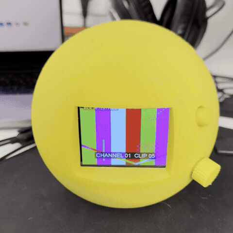
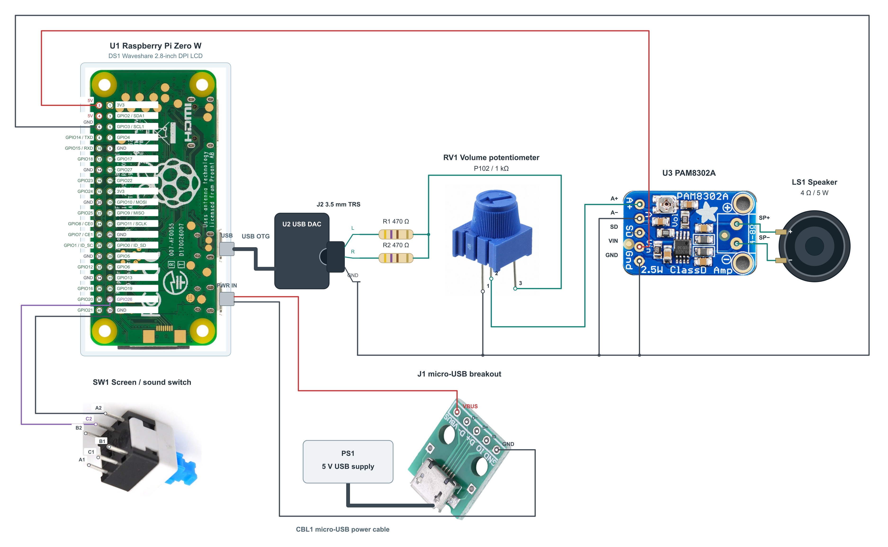
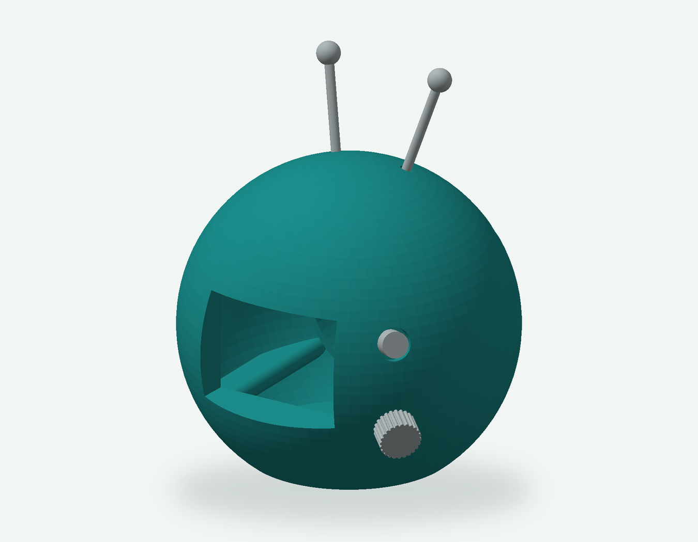

# Rick TV

**A tiny television. Your own channels.**

A Raspberry Pi TV in a 3D-printed retro enclosure, with a touchscreen, a real volume knob, and a built-in speaker.

[Build guide](docs/setup.md) · [Parts list](hardware/BOM.md) · [Wiring](hardware/README.md) · [3D files](hardware/enclosure/)

## Meet the TV

Rick TV turns a collection of videos into a little television you can leave on
your desk. Upload clips through Telegram, organize them into channels, and let
the TV play them in a loop. Swipe the screen to change channels, or use the
Telegram bot as a remote.

The Raspberry Pi Zero W drives a 2.8-inch Waveshare touchscreen. A USB audio
adapter feeds a PAM8302A mono amplifier and a 4 Ω speaker. The volume knob sets
the listening level; the switch turns the screen and sound on or off while the
Pi stays running.

- **Your own programming.** Create, rename, and delete channels from Telegram.
- **Touch or remote control.** Change channels with a swipe or a bot command.
- **Automatic delivery.** The server converts uploads to the playback format;
  the Pi downloads and verifies them before adding them to its local playlists.
- **Physical controls.** Adjust volume by hand and switch the screen and sound
  off together.
- **Printable enclosure.** Editable OpenSCAD source and an STL are included.

## Build the hardware

Start with the [bill of materials](hardware/BOM.md), then follow the
[connection guide](hardware/README.md). The diagram covers the **USB DAC
build**, including every pin on the Pi's 40-pin header.

### Enclosure

[Download STL](hardware/enclosure/tv-parametric-model.stl) ·
[OpenSCAD source](hardware/enclosure/tv-parametric-model.scad) ·
[Model details and fit notes](hardware/enclosure/README.md)

The render assembles the supplied STL using the layout in the SCAD source. Its speaker pocket is
77.5 mm across; the linked BOM speaker is 40 mm. See the enclosure notes before
printing for that speaker.

## How it works

**Telegram → server → Wi-Fi → Rick TV.** The server keeps the video library and
channel registry. The Pi stores its downloaded media on the microSD card and
plays local channel playlists through Video Looper.

- [`rick-tv-server/`](rick-tv-server/) contains the FastAPI service, media
  conversion, SQLite library, and Telegram bot. The API and bot run together in
  Docker Compose.
- [`rick-tv-pi/`](rick-tv-pi/) contains media synchronization, touch navigation,
  screen/audio control, and the Video Looper integration.
- [`hardware/`](hardware/) contains the BOM, wiring diagram, and enclosure.

## Get it running

1. **Start the server.** Configure the API token and Telegram settings in
   `rick-tv-server/.env`, then run `docker compose up -d` from `rick-tv-server/`.
2. **Prepare the Pi.** Build and flash the Rick TV image based on Video Looper
   v2.11, then add the first-boot Wi-Fi and server configuration.
3. **Choose USB audio.** Set `RICK_TV_AUDIO_PROFILE=usb-dac` for the hardware
   shown here.
4. **Add your first channel.** Open the Telegram bot, use `/add_channel`, and
   upload a video. The Pi downloads it and makes the channel playable.

The [installation guide](docs/setup.md) contains the commands and configuration.
The packaged image is built locally; this repository does not yet provide a
prebuilt image download.

## Documentation

- [Installation and operation](docs/setup.md)
- [Server configuration and API](docs/rick-tv-server.md)
- [Raspberry Pi runtime and troubleshooting](docs/rick-tv-pi.md)
- [Provisioning and image build tools](rick-tv-pi/provisioning/README.md)
- [Bill of materials](hardware/BOM.md)
- [Wiring and controls](hardware/README.md)
- [Enclosure files and dimensions](hardware/enclosure/README.md)
