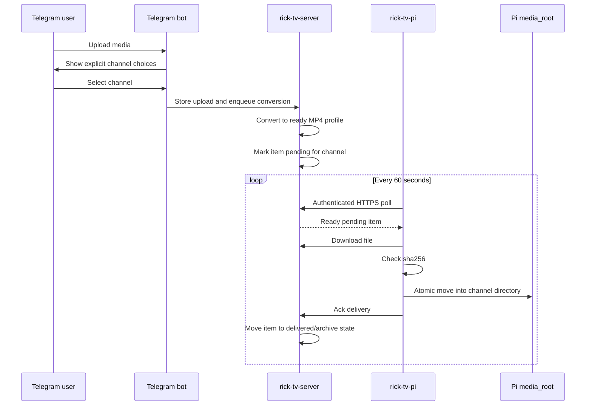
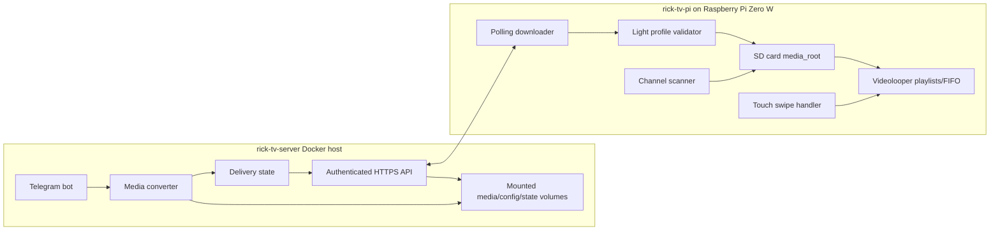
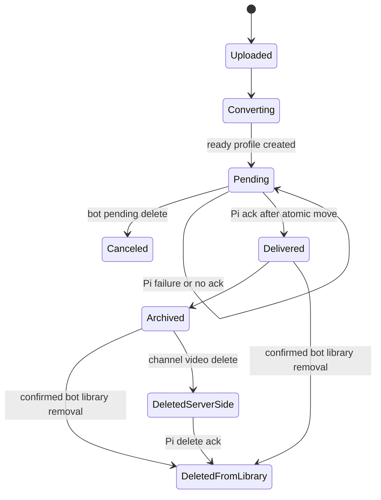

# Rick TV Design Spec

Date: 2026-05-18
Phase: 1 - Brainstorming / Design

## Scope

Rick TV is split into two projects:

- `rick-tv-pi`: Raspberry Pi appliance software that validates, downloads, stores, scans, and plays already-converted channel media.
- `rick-tv-server`: Dockerized server that receives Telegram uploads, converts media off-Pi, exposes authenticated HTTPS polling endpoints for the Pi, and manages pending/delivered media state.

Phase 1 does not implement application code. It defines the architecture, contracts, operational behavior, and verification approach for a first working system.

## Hardware Baseline

The physical build remains unchanged from the existing `raspberry-pi-tv` reference:

- Raspberry Pi Zero W.
- Waveshare 2.8inch DPI LCD.
- GPIO19 audio/PWM.
- GPIO26 old power button.
- GPIO18 existing amplifier/backlight working scheme unchanged.

The new software must adapt to that hardware instead of changing wiring, display assumptions, audio routing, power-button behavior, or the GPIO18 amplifier/backlight arrangement.

## User Interaction

Touch input is deliberately minimal:

- Swipe left anywhere on the screen switches to the next channel.
- Swipe right anywhere on the screen switches to the previous channel.
- Taps are ignored.
- Swipe handling uses debounce/cooldown so one physical gesture cannot trigger repeated channel changes.

Channel switching stays local on the Pi and does not require server access.

## Channel Model

Channels are playable directories directly under a configured `media_root`.

Example Pi storage:

```text
~/Videos/rick_tv_channels/
  01_Citadel/
  02_Interdimensional_Cable/
  Garage/
```

Eligibility and ordering rules:

1. An immediate directory under `media_root` becomes a channel only when it contains at least one playable `.mp4`.
2. Empty directories are ignored by navigation and playlist generation until a playable `.mp4` appears.
3. Eligible directories with a leading numeric prefix sort first by that number.
4. Eligible directories without a leading numeric prefix sort after numbered directories, alphabetically by directory name.
5. Nested directories are not channels.

Server-synced YAML metadata is the registry for delivery polling and Telegram channel choices. It can introduce channel IDs for first delivery, but it does not create a local navigation/playback channel until the Pi has at least one playable `.mp4` in that channel directory. If metadata is missing for a local playable channel, the UI shows only the channel number; it does not show a placeholder and does not derive a display name from the folder name.

```yaml
channels:
  01_Citadel:
    display_name: Citadel TV
```

## Pi Media Behavior

The Pi stores ready-to-play media on its SD card under `media_root`, for example `~/Videos/rick_tv_channels`.

Empty directories are not selectable channels. When a playable `.mp4` appears in an immediate directory, the next channel scan can include that directory as a channel and the videolooper playlist generation path can make it playable.

The Pi performs only authenticated polling, download, `sha256` integrity checks, atomic placement, scanning, and playback. It does not transcode uploaded media or run media-profile validation tools such as `ffprobe`.

## Server And Upload Flow

The Telegram bot runs on `rick-tv-server`.

Upload behavior:

- The bot remembers the last selected channel per Telegram user.
- Every upload flow still shows explicit channel choices; remembered selection is a convenience, not an implicit destination.
- Uploaded media is converted off-Pi on the server into the ready profile before becoming eligible for Pi download.

Bot file management:

- The bot can list and delete pending files.
- The bot can list and request deletion for delivered/archive files with confirmation.
- Deleting pending media marks it canceled so it will not be delivered to the Pi.
- Archive-list deletion is a soft library removal and keeps server files.
- Channel video deletion is a hard delete: it removes server-side original and converted files, queues a device deletion, and the Pi removes the local channel file on the next successful poll.

## Conversion Profile

Server output targets a Pi-ready MP4 profile:

- Container: MP4.
- Video: H.264.
- Pixel format: `yuv420p`.
- Audio: AAC.
- Scale: display-native target for the Waveshare 2.8inch DPI LCD.
- Bitrate: modest, tuned for SD card storage and Pi Zero W playback reliability.

The server validates that converted files match the expected ready profile before exposing them through `/api/v1/ready`. The Pi verifies delivery integrity with `sha256` when provided before atomically moving the already server-validated file into the channel directory.

## Server Deployment

`rick-tv-server` runs in Docker. `rick-tv-pi` is not Dockerized.

Server deployment expectations:

- Mounted media volume for uploaded, converted, delivered, archived, and canceled files.
- Mounted config volume for bot token, channel mapping, authentication settings, and conversion profile config.
- Mounted state volume for queue state, per-user last selected channel, delivery acknowledgements, and archive index.
- Published HTTP service reachable by the Pi over the local network or another permitted network path.
- Restart policy enabled.
- Operational logs emitted to Docker stdout/stderr.

## Pi And Server Contract

The server does not push to the Pi. The Pi exposes no open ports for Rick TV.

The Pi polls authenticated HTTPS every 60 seconds:

- Ask for ready items for known channels.
- Download one or more ready files.
- Verify payload integrity with `sha256` when provided and confirm the destination channel from the server response.
- Write to a temporary path on the SD card.
- Atomically move into the target channel directory.
- Acknowledge only after successful download, checksum verification, and atomic move.

The server keeps an item pending until the Pi acknowledgement arrives.

Failure handling:

- Failed downloads, checksum mismatches, network failures, or missed acknowledgements silently retry.
- Uploaders are not notified of delivery failures in Phase 1.
- The Pi avoids durable delivery logs for this flow; transient stdout/stderr or service journal output is acceptable for debugging, but delivery state lives on the server.
- Redelivery may redownload and atomically overwrite the existing destination file. Phase 1 does not need duplicate-transfer avoidance.



## Runtime Components



## State Model

Server-side delivery state is authoritative.



The Pi channel scanner is authoritative only for local playback availability. It discovers eligible local media directories and newly delivered files, but it does not own cross-device delivery truth.

## Error Handling

Pi behavior:

- Ignore empty channel directories until they contain a playable `.mp4`.
- Include a directory as a channel on a later scan once a playable `.mp4` exists.
- Use generated videolooper playlists and FIFO commands for Pi playback and channel switching.
- Use server-synced registry IDs for delivery polling when metadata is configured.
- Keep malformed or missing metadata out of local navigation unless a playable `.mp4` directory exists.
- Ignore taps and reject additional swipes during cooldown.
- Do not expose inbound network services for Rick TV.

Server behavior:

- Keep pending files pending until acknowledged.
- Retry silently when the Pi does not acknowledge.
- Treat pending deletion as cancellation.
- Treat archive deletion as soft removal from the active library while retaining original and converted files on disk.
- Treat channel video deletion as server file removal plus a retryable Pi deletion command.
- Use Docker stdout/stderr for logs.

## Testing And Verification

Pi-focused verification:

- Channel scanner test fixture with numbered directories, non-numbered directories, nested directories, empty directories, playable `.mp4` files, and YAML metadata that references both existing and missing directories.
- Verify numeric-prefix ordering before alphabetical non-numbered ordering.
- Verify empty directories are ignored until they contain a playable `.mp4`.
- Verify missing metadata shows only channel number, no placeholder, and no folder-derived display name.
- Verify videolooper playlist generation includes only playable channels and channel switching uses the videolooper command path.
- Verify swipe left/right changes channels, taps are ignored, and cooldown prevents repeated channel changes.
- Fake server tests for polling, authenticated HTTPS request shape, ready item download, checksum mismatch retry, successful atomic move, and acknowledgement timing.
- Fake server redelivery test confirming redownload plus atomic overwrite is acceptable.

Server-focused verification:

- Dockerized server starts with mounted media/config/state volumes and restart policy.
- Published HTTP endpoint is reachable from a Pi-equivalent client.
- Docker stdout/stderr contains operational logs.
- Telegram upload flow test verifies explicit channel choices are always shown while preserving last selected channel per user.
- Conversion test verifies ready profile output: MP4, H.264, `yuv420p`, AAC, display-native scale, modest bitrate.
- Queue test verifies pending remains pending until Pi ack.
- Cancellation test verifies pending delete marks an item canceled.
- Delivered/archive deletion test verifies confirmed archive removal hides items from the active library while retaining server-side files.

End-to-end verification:

- Upload media through Telegram, select a channel explicitly, convert on server, poll from Pi client, download, validate, atomic move, ack, and transition server item to delivered/archive.
- Simulate network interruption before ack and verify silent retry without uploader notification.
- Confirm Pi has no Rick TV inbound port requirement.

## Phase 1 Non-Goals

- No hardware changes.
- No Pi-side transcoding.
- No push delivery from server to Pi.
- No open inbound Rick TV ports on the Pi.
- No Pi Docker deployment.
- No delivered/archive deletion propagated to Pi.
- No uploader delivery-failure notification.
- No duplicate-transfer optimization.
- No application code implementation in this phase.
